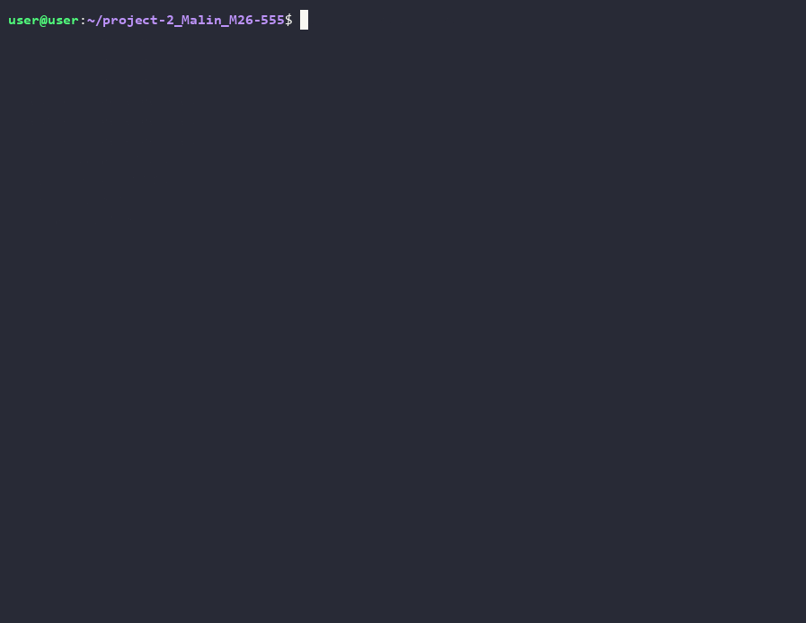

# project-2_Malin_M26-555

Программа представляет собой реализацию простой базы данных с CLI интерфейсом.
## Установка проекта
Для установки возьмите файлы *.whl из  и установите через
```
uv tool install *.whl
```
или другой способ установки .whl в вашей системе.

## Сборка проекта (dev)
Для сборки проекта используйте
```
uv build
```
Он сформирует .whl файлы в папке dist.


## Пользование проектом
Для запуска проекта просто вызовите команду
```
database
```

**Описание команд**
```
<command> create_table <имя_таблицы> <столбец1:тип> <столбец2:тип> ... - создать таблицу.
<command> list_tables - показать список всех таблиц.
<command> drop_table <имя_таблицы> - удалить таблицу.
<command> insert into <имя_таблицы> values (<значение1>, <значение2>, ...) - создать запись.
<command> select from <имя_таблицы> - прочитать записи из таблицы.
<command> update <имя_таблицы> set <столбец1> = <новое_значение1> where <столбец_условия> = <значение_условия> - обновить запись.
<command> delete from <имя_таблицы> where <столбец> = <значение> - удалить запись.
<command> info <имя_таблицы> - вывести информацию о таблице.

Общие команды:
<command> exit - выход из программы.
<command> help - справочная информация.
```
**Установка и использование проекта**
